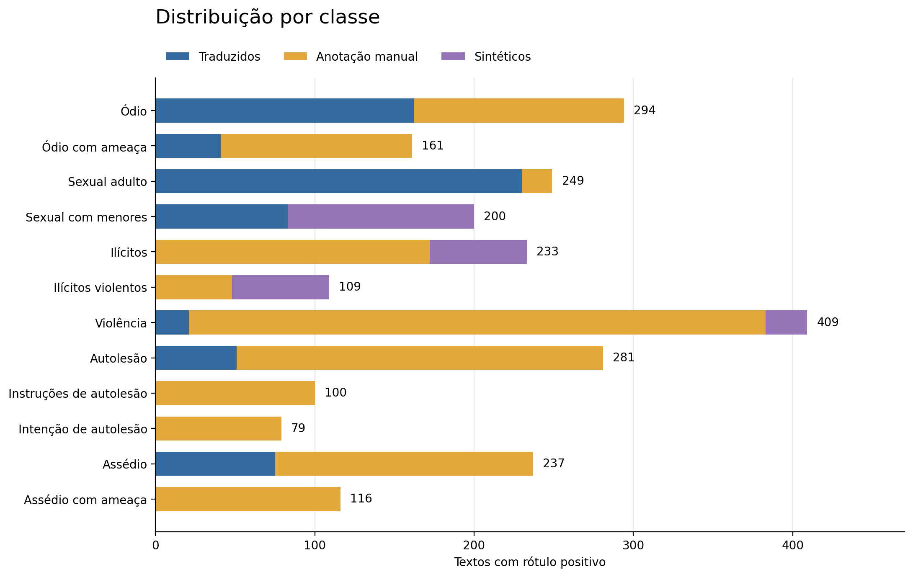

# PT-BR Moderation Eval

## Descrição

PT-BR Moderation Eval é um conjunto de dados para avaliar classificadores de conteúdo em português brasileiro. O conjunto contém 3.764 textos únicos e 12 categorias de moderação. A classificação é multirrótulo: cada texto pode pertencer a mais de uma categoria.

Os textos incluem linguagem informal, abreviações, gírias e neologismos. O conjunto combina textos traduzidos, textos com anotação manual e textos sintéticos.

## Versão dos dados

O conjunto atual está disponível no [Hugging Face](https://huggingface.co/datasets/HRB25/pt-br-moderation-eval). Este repositório mantém a documentação pública e o arquivo legado.

| Configuração | Registros | Categorias | Localização |
|---|---:|---:|---|
| `default` | 3.764 | 12 | Hugging Face |
| `sem_ambiguos_marcados` | 3.540 | 12 | Hugging Face |
| `legado` | 1.680 | 7 | Hugging Face e arquivo JSONL deste repositório |

O arquivo [huggingface_dataset_moderation_ptbr.jsonl](huggingface_dataset_moderation_ptbr.jsonl) corresponde ao legado. Esse arquivo não contém o conjunto de 3.764 textos usado na avaliação externa do BERTimbau V1.

A avaliação externa do V1 utilizou a configuração `default`, revisão [`4505bf3333f2a8f6ede3c31e3021c5f4c81ec819`](https://huggingface.co/datasets/HRB25/pt-br-moderation-eval/tree/4505bf3333f2a8f6ede3c31e3021c5f4c81ec819). Os dados atuais requerem autorização de acesso no Hugging Face.

O [registro da versão avaliada](docs/versao_avaliada_v1.json) contém o hash do dataset, o hash dos pesos e os limiares utilizados. A avaliação manteve os limiares do checkpoint. Não houve treinamento ou recalibração no conjunto externo.

## Composição

| Origem | Textos |
|---|---:|
| Traduzidos | 1.665 |
| Anotação manual | 1.921 |
| Sintéticos | 178 |
| **Total** | **3.764** |

Os textos traduzidos derivam de [OpenAI Moderation Evaluation](https://huggingface.co/datasets/mmathys/openai-moderation-api-evaluation). Essa fonte contém anotações para sete categorias.

A anotação manual abrange as 12 categorias. A coleta inclui textos selecionados por termos de busca e textos submetidos à classificação humana. Parte da amostra recebeu anotação de um único avaliador. O conjunto não apresenta uma medida de concordância entre avaliadores.

Os textos sintéticos complementam as categorias de conteúdo sexual com menores e atividades ilícitas violentas. Esses textos possuem cobertura de anotação específica por registro. A avaliação deve distinguir exemplos sintéticos de exemplos não sintéticos.

## Categorias

| Rótulo | Categoria | Positivos |
|---|---|---:|
| `hate` | Ódio | 294 |
| `hate/threatening` | Ódio com ameaça | 161 |
| `sexual` | Conteúdo sexual adulto | 249 |
| `sexual/minors` | Conteúdo sexual com menores | 200 |
| `illicit` | Atividades ilícitas | 233 |
| `illicit/violent` | Atividades ilícitas violentas | 109 |
| `violence` | Violência | 409 |
| `self-harm` | Autolesão | 281 |
| `self-harm/instructions` | Instruções de autolesão | 100 |
| `self-harm/intent` | Intenção de autolesão | 79 |
| `harassment` | Assédio | 237 |
| `harassment/threatening` | Assédio com ameaça | 116 |

As contagens indicam textos com rótulo positivo. A soma excede o total de textos porque as categorias podem ocorrer no mesmo registro.



## Estrutura

O formato JSONL contém um registro por linha.

| Campo | Definição |
|---|---|
| `id` | Identificador do texto normalizado |
| `text` | Texto para classificação |
| `labels` | Categorias com rótulo positivo |
| `annotated_categories` | Categorias avaliadas na anotação do registro |
| `source` | Origem: `traduzido`, `manual` ou `sintetico` |
| `synthetic` | Indica se o texto é sintético |
| Colunas das 12 categorias | Valores binários: `1` indica rótulo positivo; `0` indica ausência de rótulo positivo |

As colunas de categoria não contêm valores nulos. As posições sem anotação são representadas por `0`. Essa representação não confirma um rótulo negativo nessas posições. O campo `annotated_categories` delimita a cobertura válida para o cálculo das métricas.

## Avaliação

```python
from datasets import load_dataset

dataset = load_dataset(
    "HRB25/pt-br-moderation-eval",
    "default",
    split="test",
    revision="4505bf3333f2a8f6ede3c31e3021c5f4c81ec819",
)
```

A configuração `default` contém os 3.764 textos. A configuração `sem_ambiguos_marcados` contém 3.540 textos e exclui os registros marcados como ambíguos. Essa marcação não está disponível para todo o conjunto.

A configuração `legado` contém os 1.680 registros do conjunto original. Seu esquema conserva as categorias originais.

O cálculo de precisão, recall, F1 e suporte considera apenas as categorias presentes em `annotated_categories`. Os valores preenchidos com `0` fora dessa cobertura devem ser excluídos das métricas. A entrada do classificador utiliza somente o campo `text`.

A descrição dos resultados deve informar a revisão do conjunto, o modelo e os limiares utilizados. Os resultados por origem permitem comparar textos traduzidos, textos com anotação manual e textos sintéticos. A reprodução exige a revisão do repositório no parâmetro `revision`.

## Limitações

A distribuição das categorias é desbalanceada. A seleção por termos de busca favorece categorias específicas. O conjunto não representa a frequência de conteúdo nocivo em uma plataforma.

A tradução pode alterar o sentido e o uso de expressões. Variações sintéticas podem apresentar dependência entre exemplos. O número de textos não equivale ao número de situações independentes.

Alguns rótulos dependem de contexto, ironia ou interpretação. Ofertas de armas não comprovam, isoladamente, uma atividade ilícita. Relatos passados de autolesão não confirmam, isoladamente, intenção atual.

A anotação manual de `self-harm/instructions` inclui pedidos, busca e planejamento de métodos. A anotação de `illicit` inclui relatos e conversas sobre drogas. Essas definições podem diferir das políticas adotadas por outros classificadores.

A consolidação remove duplicatas exatas após normalização Unicode, caixa e espaços. Também remove novos registros coincidentes com as partições históricas do BERTimbau V1. Esse processo não identifica todas as paráfrases.

Registros com pendência explícita de revisão não integram os splits de avaliação. O uso do conjunto para treinamento ou calibração impede tratá-lo, posteriormente, como teste independente.

O conjunto contém conteúdo sensível para pesquisa em moderação. A licença declarada é MIT.

## Documentação

- [Distribuição por categoria e origem](analysis/distribuicao_classes.csv)
- [Análise da distribuição](analysis/estudo_distribuicao.md)
- [Registro do processamento](analysis/manifesto.json)
